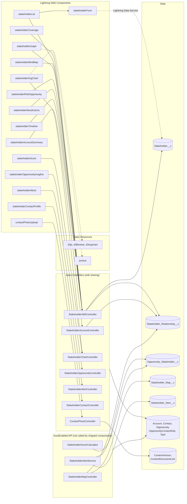
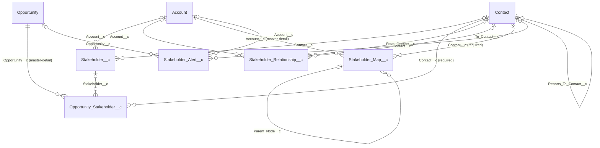

# Stakeholder360

Visual relationship mapping and stakeholder intelligence for complex B2B deals, built natively on Salesforce.

[](https://login.salesforce.com/packaging/installPackage.apexp?p0=04tf6000000EtflAAC)
[](https://test.salesforce.com/packaging/installPackage.apexp?p0=04tf6000000EtflAAC)

Stakeholder360 helps sales teams map who matters on an Account or Opportunity: each person's role and influence, how they relate to one another, and where coverage is missing. It scores engagement, raises alerts when relationships go cold or key roles are uncovered, and suggests next best actions.

## Managed Package

| | |
|---|---|
| Package name | Stakeholder360 (first-generation managed package) |
| Namespace | `Stakeholder360` |
| Packaging org | `stakeholder360@revcodex.com` (Org ID `00Df600000GXWuLEAX`) |
| Released version | 1.0.0 (Spring 2026) |
| Version ID | `04tf6000000EtflAAC` |

Install links:

- Production / Developer Edition: https://login.salesforce.com/packaging/installPackage.apexp?p0=04tf6000000EtflAAC
- Sandbox: https://test.salesforce.com/packaging/installPackage.apexp?p0=04tf6000000EtflAAC

The package contents match everything under `force-app/` (140 components, verified on 2026-10-06).

> Note: `sfdx-project.json` has an empty `namespace`. Source is deployed to the packaging org and added to the package there, and the org applies the `Stakeholder360` namespace.

## Architecture

Stakeholder360 has three layers: Lightning Web Components on the record pages, Apex controllers that read and write data, and the custom and standard objects underneath. There are no triggers, flows or scheduled jobs. All logic runs on demand when a component loads or a user takes an action.

### Component Architecture



Every controller queries the standard objects, so that link is drawn once for each group instead of once for each class.

Notes:

- `stakeholderAlerts` gets its alerts from `StakeholderAlertController`, which builds them live from Opportunity Contact Roles and Contacts. It does not read `Stakeholder_Alert__c` records.
- `StakeholderMapController`, `StakeholderAlertService` and `StakeholderScoreCalculator` expose `@AuraEnabled` methods and are granted in all three permission sets, but no component in this package calls them. They are the only code that works with `Stakeholder_Map__c`, `Stakeholder_Alert__c` and `Opportunity_Stakeholder__c`.

### Record Page Placement

| Record page | Components |
|---|---|
| Account | `stakeholderAccountSummary`, `stakeholderOrgChart`, `stakeholderGraph`, `stakeholderMindMap`, `stakeholderList`, `stakeholderCoverage`, `stakeholderRiskOpportunity`, `stakeholderNextActions`, `stakeholderTimeline` |
| Opportunity | `stakeholderOpportunityInsights`, `stakeholderOrgChart`, `stakeholderGraph`, `stakeholderScore`, `stakeholderAlerts` |
| Contact | `stakeholderContactProfile`, `contactPhotoUpload` |

`stakeholderForm` is not placed on a page directly. It opens from `stakeholderList`.

### Data Model



All relationships are lookups unless marked master-detail. `Opportunity_Stakeholder__c` is deleted with its Opportunity, and `Stakeholder_Map__c` is deleted with its Account.

## What's Included

### Custom Objects

| Object | Purpose |
|---|---|
| `Stakeholder__c` | Links a Contact to an Account with decision data: role, influence, decision power, sentiment, engagement level, priority score, risk flag |
| `Opportunity_Stakeholder__c` | Junction between Opportunity and Stakeholder/Contact for deal-specific role, influence, engagement and relationship strength |
| `Stakeholder_Relationship__c` | Relationship between two Contacts (type, direction, strength, risk) to expose hidden power dynamics |
| `Stakeholder_Map__c` | Org chart node positions, layers and layout preferences |
| `Stakeholder_Alert__c` | Coverage gap alerts with type, severity, priority, status and recommendations |

### Fields on Standard Objects

- **Account:** `Stakeholder_Count__c`, `Org_Chart_Last_Updated__c`
- **Contact:** `Stakeholder_Score__c`, `Relationship_Strength__c`, `Last_Engagement_Date__c`, `Reports_To_Contact__c`, `Photo_URL__c`
- **Opportunity:** `Stakeholder_Count__c`, `Stakeholder_Score__c`

### Lightning Web Components

| Component | Label | Description |
|---|---|---|
| `stakeholderAccountSummary` | Account Stakeholder Summary | Stakeholder overview and key metrics for an Account |
| `stakeholderOrgChart` | Stakeholder Chart | Hierarchical org chart of Opportunity/Account contacts (d3, d3-flextree, d3-org-chart) |
| `stakeholderGraph` | Stakeholder Network Graph | Network view of stakeholder relationships (jsMind) |
| `stakeholderMindMap` | Stakeholder Tree | Tree grouping stakeholders by role and category |
| `stakeholderList` | Stakeholder List | Sortable, filterable list with quick actions |
| `stakeholderForm` | Stakeholder Form | Create and edit stakeholder records |
| `stakeholderCoverage` | Stakeholder Coverage Analysis | Role coverage analysis for an Account |
| `stakeholderScore` | Stakeholder Score | Engagement scores and health metrics |
| `stakeholderRiskOpportunity` | Risk & Opportunity Engine | Risk signals and opportunity indicators |
| `stakeholderNextActions` | Next Best Actions | Prioritized engagement actions |
| `stakeholderAlerts` | Stakeholder Alerts | Critical relationship alerts |
| `stakeholderOpportunityInsights` | Stakeholder Opportunity Insights | Stakeholder insights and engagement analytics for Opportunities |
| `stakeholderContactProfile` | Stakeholder Contact Profile | Stakeholder profile and relationship details for a Contact |
| `stakeholderTimeline` | Stakeholder Timeline | Timeline of stakeholder changes and relationship events |
| `contactPhotoUpload` | Contact Photo Upload | Upload and manage Contact photos |

Most components can be placed on Record, App and Home pages.

### Apex Classes

Each class has a matching `*Test` class.

| Class | Responsibility |
|---|---|
| `Stakeholder360Controller` | Core API: stakeholder and relationship CRUD, coverage analysis, risk and opportunity signals, next best actions, timeline, tree and graph data |
| `StakeholderAccountController` | Account summary and key contacts |
| `StakeholderOpportunityController` | Opportunity stakeholder insights |
| `StakeholderContactController` | Contact profile data |
| `StakeholderChartController` | Org chart data, adding and removing Contacts on an Opportunity, contact relationship updates and scoring |
| `StakeholderMapController` | `Stakeholder_Map__c` and `Stakeholder_Relationship__c` CRUD and node position saving |
| `StakeholderAlertController` | Alerts for an Opportunity or Account |
| `StakeholderAlertService` | Generates coverage alerts for Opportunities and updates or dismisses them |
| `StakeholderScoreCalculator` | Opportunity-level stakeholder score and score breakdown |
| `ContactPhotoController` | Upload, fetch and delete Contact photos |

### App, Pages and Other Metadata

- **Lightning App:** Stakeholder360
- **Record pages:** `Account_Record_Page_Stakeholder360`, `Contact_Record_Page_Stakeholder360`, `Opportunity_Record_Page_Stakeholder360`
- **Tabs:** one for each custom object
- **Page layouts:** one for each custom object, plus the Stakeholder360 Contact Layout
- **Quick action:** `SendEmail`
- **Static resources:** `d3js`, `d3flextree`, `d3orgchart`, `jsmind`
- **Content asset:** `stakeholder360_logo`
- **Reports** (folder `Stakeholder_360_Reports`): All Stakeholders, Stakeholders by Role, Champions by Account, Blockers by Account, High Risk Stakeholders, Cold Stakeholders (30+ Days), Stakeholder Relationships

### Permission Sets

| Permission Set | Access |
|---|---|
| Stakeholder360 Admin | Full access and configuration |
| Stakeholder360 Manager | Create, read and edit all team data. No delete. |
| Stakeholder360 User | Create and edit own records. Read only on alerts and scores. |

## Post-Install Setup

1. Assign the right permission set (Admin, Manager or User) to each user.
2. Activate the Stakeholder360 record pages for Account, Contact and Opportunity (Lightning App Builder, then Activation), or add the components to your existing pages.
3. Open the **Stakeholder360** app from the App Launcher.

## Development

### Prerequisites

- [Salesforce CLI](https://developer.salesforce.com/tools/salesforcecli)
- VS Code with the Salesforce Extension Pack
- Node.js (for linting, formatting and LWC Jest tests)

### Project Structure

```
force-app/main/default/
  applications/   Lightning app
  classes/        Apex controllers, services and tests
  contentassets/  Logo
  flexipages/     Record pages
  layouts/        Page layouts
  lwc/            Lightning Web Components
  objects/        Custom objects and fields on standard objects
  permissionsets/ Admin, Manager, User
  quickActions/   SendEmail
  reports/        Stakeholder_360_Reports
  staticresources/ d3, d3-flextree, d3-org-chart, jsMind
  tabs/           Custom object tabs
manifest/package.xml
config/           Scratch org definition
```

### Deploy to the Packaging Org

```bash
sf org login web --alias vscodeOrg
sf project deploy start --source-dir force-app --target-org vscodeOrg
sf apex run test --target-org vscodeOrg --test-level RunLocalTests --wait 20
```

New components must also be added to the package in the packaging org (Setup, then Package Manager, then Stakeholder360, then Add) before you upload a new version.

### Check the Package Against Local Source

```bash
sf project retrieve start --target-org vscodeOrg --package-name Stakeholder360 --target-metadata-dir ./pkg-check --unzip
sf project generate manifest --source-dir force-app --name local.xml
```

Compare `pkg-check/unpackaged/Stakeholder360/package.xml` with `local.xml`.

### Local Tooling

```bash
npm install
npm run lint              # ESLint for LWC
npm run test:unit         # LWC Jest tests
npm run prettier          # Format source
```

Husky and lint-staged run formatting and linting on commit.
